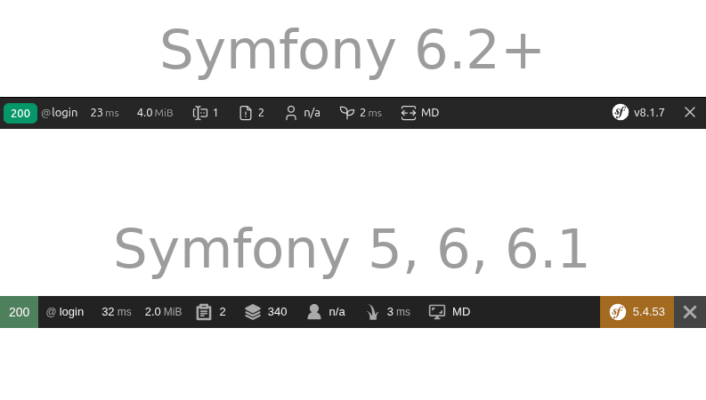

# BootstrapIndicatorBundle

Add a viewport indicator to Symfony's toolbar to show the current viewport breakpoint for
[Bootstrap](https://getbootstrap.com/docs/5.3/layout/breakpoints).




## Installation

This bundle is compatible with all Symfony versions from 5.4 and up. Install it with Composer.

```shell
composer require --dev mesavolt/bootstrap-indicator-bundle
```

If necessary, adjust the values of the environments in which you want to enable this bundle by editing
`config/bundles.php`.

```php
// config/bundles.php

return [
    Symfony\Bundle\FrameworkBundle\FrameworkBundle::class => ['all' => true],
    // [...]
    // edit the environments on this line if necessary 👇
    Mesavolt\BootstrapIndicatorBundle\MesavoltBootstrapIndicatorBundle::class => ['dev' => true],
];
```
